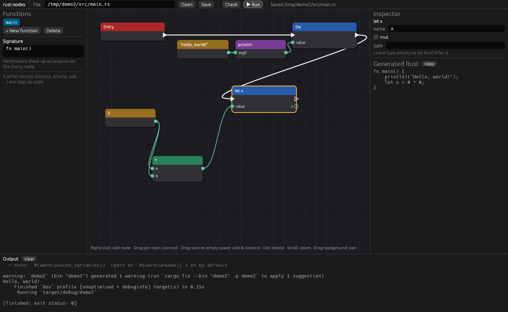
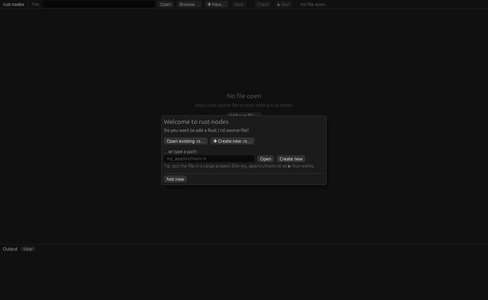

# rust-nodes

A node-based, Blueprint-style visual editor for **general-purpose Rust**. It's fully open source, including the editor.

The nodes aren't a separate language. They are a **view of real Rust code**. Open any `.rs` file and it shows up as a graph. Edit the graph and it's saved back as normal, readable Rust that compiles with plain `cargo` (so you get LLVM, optimizations and every platform rustc supports).



> **Status: early prototype.** The core idea works end to end (Rust → nodes → Rust → `cargo run`), but expect rough edges.

## Quick start

```sh
git clone https://github.com/EilTalrent/rust-nodes
cd rust-nodes
cargo run --release
```

The app opens with a blank window and asks whether you want to add a Rust (`.rs`) source file:



* **Open existing .rs…** opens your system's file picker
* **Create new .rs…** picks a location and creates a hello-world starter file
* or type a path and press **Open** / **Create new**
* **Not now** leaves the window blank. You can add a file later with **Browse… / New…** in the toolbar or the **Add a .rs file…** button.

You can also open a file straight away: `cargo run --release -- examples/demo/src/main.rs`. If the file doesn't exist yet, the prompt opens with its path filled in, ready to create.

Then press **▶ Run** in the toolbar. The editor saves, runs `cargo run` in the project that contains the file, and shows the output at the bottom.

On Linux you may need the usual egui/winit system packages (X11/Wayland and OpenGL dev libraries).

## How it works

```
 your_file.rs  ──syn──▶  node graph  ──codegen + prettyplease──▶  your_file.rs  ──cargo──▶  binary
      ▲                     │
      └── layout sidecar ───┘   your_file.rs.nodes.json (node positions)
```

* **The `.rs` file is always the source of truth.** Other people can use a normal text editor, and git diffs stay readable.
* Node positions are stored next to it in `your_file.rs.nodes.json`. If the `.rs` was changed in a text editor, it is re-read and positions are kept where the structure still matches.
* Anything the graph can't show yet is kept as a **raw Rust node** (a node that holds code), so opening and saving a file never loses code.

### Rust → nodes

| Rust | Node |
|---|---|
| function | its own graph, starting at an **Entry** node whose outputs are the parameters |
| statements | nodes linked by **white exec wires** (the order things run) |
| expressions | nodes linked by **green data wires** (values flowing in) |
| `let x = …` | **let** node; its output pin *is* the variable. Uses of `x` are wires from it |
| `x = …`, `x += …` | **Assign** |
| `if` / `else if` / `else` | **If** with `then` / `else` / `next` exec pins |
| `while`, `loop`, `for x in …` | loop nodes with `body` / `next` pins (`for` outputs `x`) |
| `return`, `break`, `continue` | flow nodes (the final return is written as a tail expression) |
| `a + b`, `!x`, `&x`, `&mut x`, `*x` | operator nodes (parentheses are added automatically from precedence) |
| `f(a)`, `x.method(a)`, `println!(…)`, `x.field`, `x[i]` | call / method / macro / field / index nodes |
| `impl` blocks | each method is its own graph (`Type::method`) |
| `match`, closures, `if let`, labelled loops, structs/enums/traits … | kept as raw Rust (for now) |

Shadowing works naturally: in `let x = 1; let x = x + 1;` the second `let` is wired to the first.

## Using the editor

* **Right-click** the canvas → add a node (with search)
* **Drag from a pin to a pin** → connect
* **Drag a wire into empty space** → the add menu opens, showing only nodes that fit, and the new node is connected for you
* **Drag from a connected input** → pick the wire back up
* **Drag a node header** → move it · **Delete/Backspace** → delete · right-click a node → Delete / Duplicate
* **Scroll** → zoom · **drag the background** → pan
* **Inspector** (right) edits the selected node: names, operators, argument counts, raw code…
* **Generated Rust** (right) updates live as you edit
* **Left panel**: functions in the file, add/delete functions, edit the signature (parameters become Entry outputs)
* **Check / Run** → `cargo check` / `cargo run`. The file must be inside a cargo project.

Unconnected inputs generate `todo!("unconnected pin")`, so half-finished graphs still compile.

## Command line

```sh
rust-nodes                        # open the editor (blank, asks for a .rs file)
rust-nodes FILE.rs                # open the editor on FILE.rs
rust-nodes --roundtrip FILE.rs    # parse to a graph and print the regenerated Rust
rust-nodes --graph FILE.rs        # print the graph as JSON
```

## Project layout

| File | What it does |
|---|---|
| `src/graph.rs` | the graph model: nodes, pins, exec/data wires |
| `src/parse.rs` | Rust → graph (`syn`) |
| `src/codegen.rs` | graph → Rust (precedence-aware, formatted with `prettyplease`) |
| `src/layout.rs` | node geometry and automatic layout |
| `src/project.rs` | open/save, layout sidecar, finding the cargo project |
| `src/editor.rs` | the node canvas and inspector (`egui`) |
| `src/app.rs` | the app window, panels, running cargo |
| `src/tests.rs` | round-trip tests (`cargo test`) |

## Known limitations

* Comments inside function bodies are lost when the editor saves. Doc comments and attributes on items are kept.
* A value node wired into several places is written out at each use. Use a `let` to compute something once.
* Compile errors appear in the output panel but aren't highlighted on the nodes yet.
* No undo yet.

## Roadmap ideas

- [ ] Map `cargo` errors (they come with line numbers) back onto nodes and highlight them
- [ ] Type info from rust-analyzer: colour pins by type, catch bad wires before compiling
- [ ] Auto-generate nodes for every function in a crate (via rustdoc JSON) so you can search the whole ecosystem
- [ ] `match` and `if let` nodes with one exec pin per arm
- [ ] Closures as collapsible sub-graphs
- [ ] Undo/redo, copy/paste, comment boxes, reroute nodes
- [ ] Keep comments by storing them on nodes
- [ ] Other backends (C, direct LLVM via `inkwell`) using the same graph

## License

MIT
