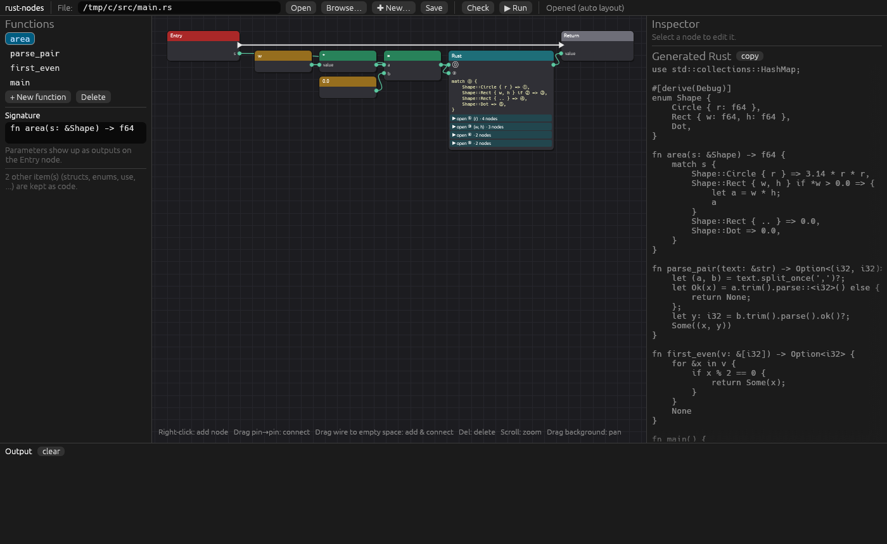
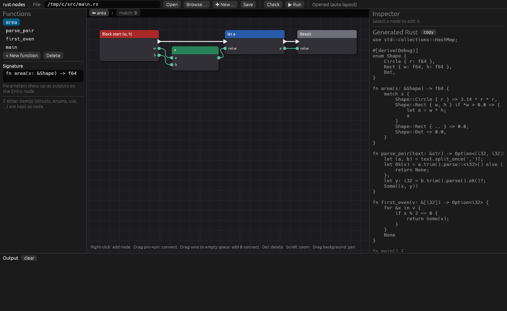
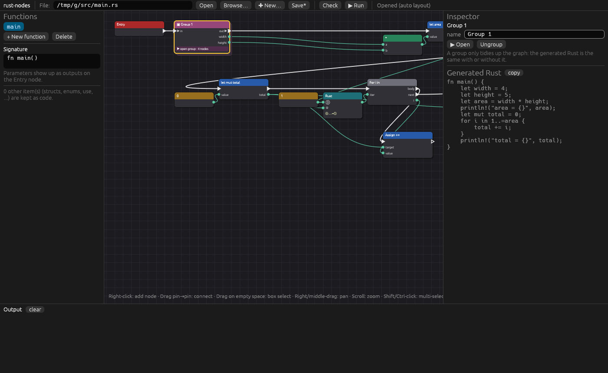
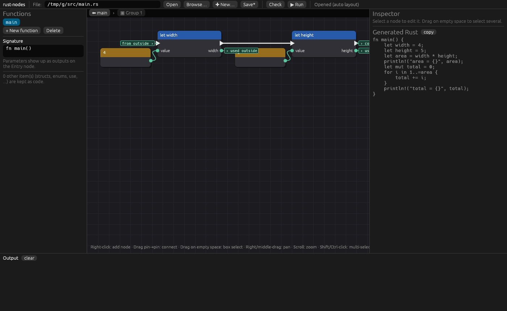
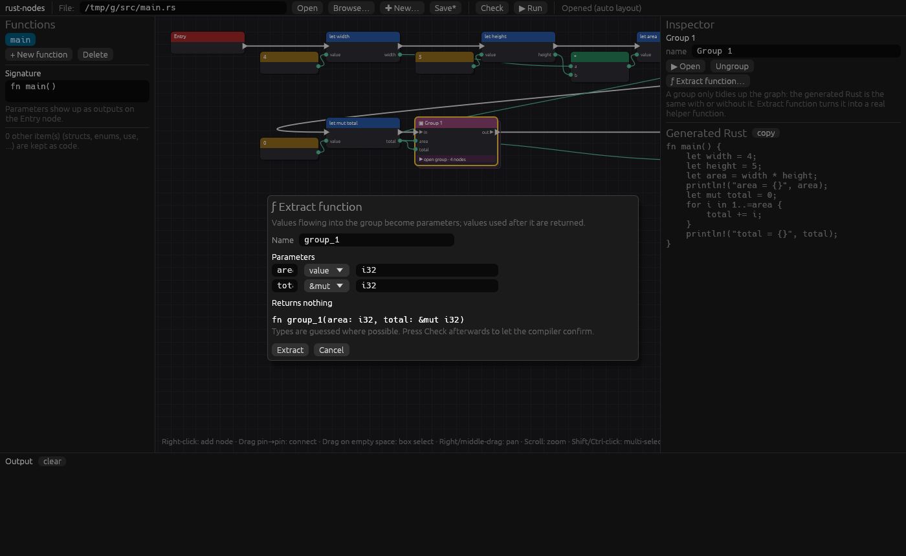
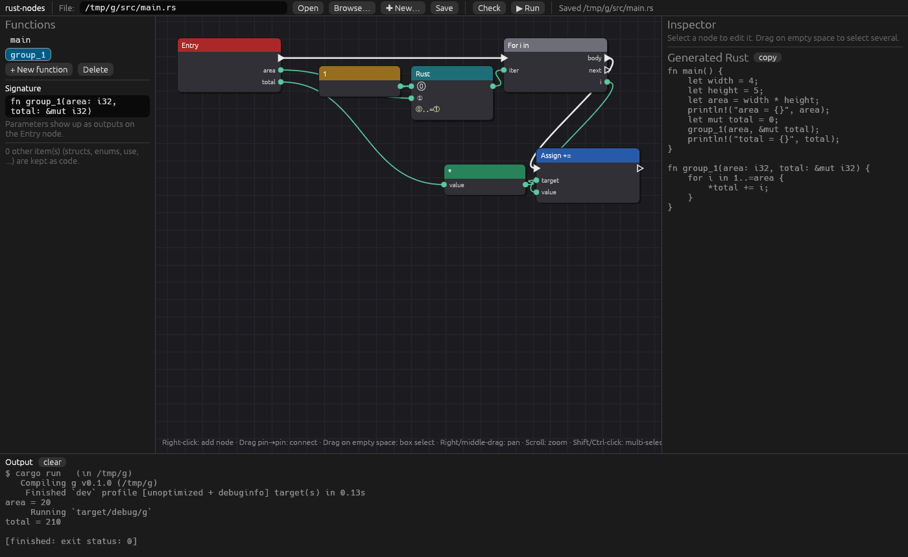

# rust-nodes

A node-based, Blueprint-style visual editor for **general-purpose Rust**. It's fully open source, including the editor.

The nodes aren't a separate language. They are a **view of real Rust code**. Open any `.rs` file and it shows up as a graph. Edit the graph and it's saved back as normal, readable Rust that compiles with plain `cargo` (so you get LLVM, optimizations and every platform rustc supports).


> **Status: early prototype.** The core idea works end to end (Rust → nodes → Rust → `cargo run`), but expect rough edges.

## Quick start

```sh
git clone https://github.com/EilTalrent/rust-nodes
cd rust-nodes
cargo run --release
```

The app opens with a blank window and asks whether you want to add a Rust (`.rs`) source file:


* **Open existing .rs…** opens your system's file picker
* **Create new .rs…** picks a location and creates a hello-world starter file
* or type a path and press **Open** / **Create new**
* **Not now** leaves the window blank. You can add a file later with **Browse… / New…** in the toolbar or the **Add a .rs file…** button.

You can also open a file straight away: `cargo run --release -- examples/demo/src/main.rs`. If the file doesn't exist yet, the prompt opens with its path filled in, ready to create.

Then press **▶ Run** in the toolbar. The editor saves, runs `cargo run` in the project that contains the file, and shows the output at the bottom.

On Linux you may need the usual egui/winit system packages (X11/Wayland and OpenGL dev libraries).

## How it works

```
 your_file.rs  ──syn──▶  node graph  ──codegen + prettyplease──▶  your_file.rs  ──cargo──▶  binary
      ▲                     │
      └── layout sidecar ───┘   your_file.rs.nodes.json (node positions)
```

* **The `.rs` file is always the source of truth.** Other people can use a normal text editor, and git diffs stay readable.
* Node positions are stored next to it in `your_file.rs.nodes.json`. If the `.rs` was changed in a text editor, it is re-read and positions are kept where the structure still matches.
* Anything without a dedicated node becomes a **template node** with holes (see below), so opening and saving a file never loses code.

### Rust → nodes

| Rust | Node |
|---|---|
| function | its own graph, starting at an **Entry** node whose outputs are the parameters |
| statements | nodes linked by **white exec wires** (the order things run) |
| expressions | nodes linked by **green data wires** (values flowing in) |
| `let x = …` | **let** node; its output pin *is* the variable. Uses of `x` are wires from it |
| `x = …`, `x += …` | **Assign** |
| `if` / `else if` / `else` | **If** with `then` / `else` / `next` exec pins |
| `while`, `loop`, `for x in …` | loop nodes with `body` / `next` pins (`for` outputs `x`) |
| `return`, `break`, `continue` | flow nodes (the final return is written as a tail expression) |
| `a + b`, `!x`, `&x`, `&mut x`, `*x` | operator nodes (parentheses are added automatically from precedence) |
| `f(a)`, `x.method(a)`, `println!(…)`, `x.field`, `x[i]` | call / method / macro / field / index nodes |
| `impl` blocks | each method is its own graph (`Type::method`) |
| `match`, closures, `if let`, `while let`, let-else, struct literals, ranges, `?`, labelled loops … | **template nodes** with holes and **containers** (below) |
| structs, enums, traits, `use` … | kept as Rust code around the graphs |

Shadowing works naturally: in `let x = 1; let x = x + 1;` the second `let` is wired to the first.

## Template nodes and containers

Rust has far more syntax than any fixed set of nodes. So instead of giving up on unfamiliar code, rust-nodes uses `syn`'s full syntax tree to break **any** construct into a **template**: the construct's own code with numbered holes cut out of it.

* **Expression holes** (⓪ ① …) are inputs. Whatever was there becomes ordinary nodes wired in.
* **Block holes** are **containers**: a sub-graph of their own. Click **▶ open** on the node (or double-click it) to go inside. A breadcrumb at the top takes you back out, and **Esc** goes up one level.
* Variables the construct creates for the block (`v` in `Some(v) => …`, `x` in `|x| …`, `(a, b)` in `if let`) come out of the container's **Block start** node as wires.
* The block's value (a match arm's or closure's result) goes into the **Result** node.
* A value used inside a container but defined outside it (like a closure capturing `offset`) gets a small `offset ›` label at the input.

```rust
match s {
    Shape::Circle { r } => 3.14 * r * r,
    Shape::Rect { w, h } if *w > 0.0 => { let a = w * h; a }
    Shape::Dot => 0.0,
}
```
becomes one node, `match ⓪ { Shape::Circle { r } => ①, Shape::Rect { w, h } if ② => ③, Shape::Dot => ④ }`. Hole ⓪ is wired from `s`, ② from a `*w > 0.0` node graph, and ①, ③ and ④ are containers:




This is similar to Unreal's collapsed graphs, Blender node groups and Houdini subnetworks, combined with Scratch/Blockly-style "code with slots". Templates nest freely: a closure inside a `match` arm inside a `for` is a container inside a container. The only code still kept as plain text is code with nothing inside it to split out, like `break 'outer;`.

## Groups (collapse nodes)

Select some nodes and press **Ctrl+G** (or **▣ Collapse into a group** in the inspector, or right-click → *Collapse into a group*) to fold them into one group node, like Unreal's collapsed graphs.

* Wires that cross the group's edge become pins on the group node: `▶ in` / `out ▶` for execution and the value's name for data.
* **▶ open group** (or double-click) shows the nodes inside. Labels like `from outside`, `used outside` and `continues outside` mark wires that leave the group.
* Groups nest, can be renamed in the inspector, and **Ungroup** puts the nodes back.
* **Groups are visual only: the generated Rust is exactly the same with or without them.** Wrapping nodes in a real `{ }` block would change which variables are visible afterwards, so groups never do that. They're saved in the `.nodes.json` layout file and are kept when the `.rs` is edited in a text editor and re-read.




### Extract function

A group can become a **real Rust function**: right-click it → **ƒ Extract function…**, or use the button in the inspector.

* Values flowing **into** the group become **parameters**. A variable that the group changes (assigned to, `&mut`, or a mutating method call on a `let mut`) is passed as `&mut`, and uses inside become `*name`.
* Values used **after** the group are **returned**. Several are returned as a tuple and unpacked at the call site.
* The group is replaced by the call, e.g. `group_1(area, &mut total);` or `let area = compute_area(width, height);`, and the new function appears in the function list with its own graph.
* The dialog lets you rename the function and parameters, choose value / `&` / `&mut`, and fill in types. Types are guessed from literals, annotations, the function's signature and simple operations. Press **Check** afterwards to let the compiler confirm.
* Groups whose meaning would change inside another function are refused with a reason: `return`, `?`, a `break`/`continue` for a loop outside the group, or execution entering or leaving the group in more than one place.

Collapsing a loop or `if` automatically brings along its body and the value nodes that only feed it.




## Using the editor

* **Right-click** the canvas → add a node (with search)
* **Drag from a pin to a pin** → connect
* **Drag a wire into empty space** → the add menu opens, showing only nodes that fit, and the new node is connected for you
* **Drag from a connected input** → pick the wire back up
* **Drag on empty space** → box-select · **Shift/Ctrl-click** → add to or remove from the selection · **Ctrl+A** → select all
* **Drag a node** → moves it (or the whole selection) · **Delete/Backspace** → delete · right-click a node → Delete / Duplicate / Collapse
* **Ctrl+G** → collapse the selection into a group · **Ungroup** in the inspector or right-click menu
* **Right- or middle-drag** → pan
* **▶ open** rows / **double-click** a template → go into a container · breadcrumb or **Esc** → back out
* **Scroll** → zoom
* **Inspector** (right) edits the selected node: names, operators, argument counts, raw code…
* **Generated Rust** (right) updates live as you edit
* **Left panel**: functions in the file, add/delete functions, edit the signature (parameters become Entry outputs)
* **Check / Run** → `cargo check` / `cargo run`. The file must be inside a cargo project.

Unconnected inputs generate `todo!("unconnected pin")`, so half-finished graphs still compile.

## Command line

```sh
rust-nodes                        # open the editor (blank, asks for a .rs file)
rust-nodes FILE.rs                # open the editor on FILE.rs
rust-nodes --roundtrip FILE.rs    # parse to a graph and print the regenerated Rust
rust-nodes --graph FILE.rs        # print the graph as JSON
```

## Project layout

| File | What it does |
|---|---|
| `src/graph.rs` | the graph model: nodes, pins, exec/data wires |
| `src/parse.rs` | Rust → graph (`syn`) |
| `src/codegen.rs` | graph → Rust (precedence-aware, formatted with `prettyplease`) |
| `src/layout.rs` | node geometry and automatic layout |
| `src/project.rs` | open/save, layout sidecar, finding the cargo project |
| `src/extract.rs` | turning a group into a function: parameters, returns, `&mut`, safety checks |
| `src/editor.rs` | the node canvas and inspector (`egui`) |
| `src/app.rs` | the app window, panels, running cargo |
| `src/tests.rs` | round-trip tests (`cargo test`) |

## Known limitations

* Comments inside function bodies are lost when the editor saves. Doc comments and attributes on items are kept.
* A value node wired into several places is written out at each use. Use a `let` to compute something once.
* Inside templates, names bound by patterns and used in guard expressions (e.g. `*w > 0.0`) are matched by name, not by wire. The same goes for calling a closure stored in a variable (`add(1, 2)`).
* Editing a template's code by hand works, but keep the `⟦n⟧` hole markers.
* Compile errors appear in the output panel but aren't highlighted on the nodes yet.
* No undo yet.

## Roadmap ideas

- [ ] Map `cargo` errors (they come with line numbers) back onto nodes and highlight them
- [ ] Type info from rust-analyzer: colour pins by type, catch bad wires before compiling
- [ ] Auto-generate nodes for every function in a crate (via rustdoc JSON) so you can search the whole ecosystem
- [ ] Dedicated `match` / `if let` nodes with one exec pin per arm (on top of the generic templates)
- [x] Collapse a selection into a group / ungroup
- [x] Turn a group into a real Rust helper function ("extract function")
- [ ] Ask the compiler for unknown types when extracting (the `let _: () = value;` trick)
- [ ] Undo/redo, copy/paste, comment boxes, reroute nodes
- [ ] Keep comments by storing them on nodes
- [ ] Other backends (C, direct LLVM via `inkwell`) using the same graph

## License

MIT
